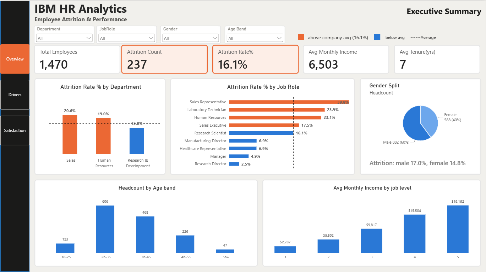
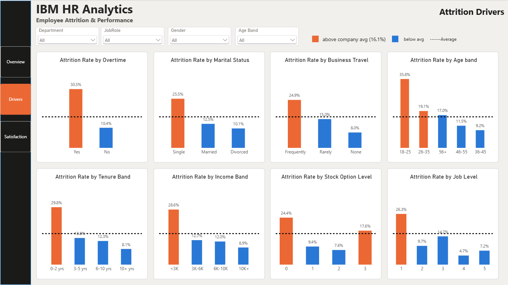
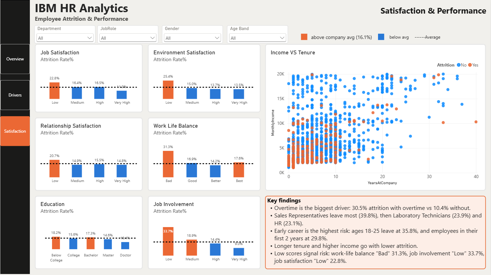

# 📊 HR Attrition Analysis | Power BI Project

**An interactive HR Analytics project built using Power BI, Power Query and DAX to analyze employee attrition, identify potential reasons for employee exits, and support data-driven workforce retention decisions.**

<p align="left">
  
  
  
</p>

---

## 📑 Table of Contents

1. [Project Overview](#-project-overview)
2. [Business Problem](#-business-problem)
3. [Business Questions](#-business-questions)
4. [Dataset Description](#-dataset-description)
5. [Tools & Technologies](#-tools--technologies)
6. [Project Workflow](#-project-workflow)
7. [Data Quality Assessment](#-data-quality-assessment)
8. [Data Modelling](#-data-modelling)
9. [DAX Measures](#-dax-measures)
10. [Dashboard Overview](#-dashboard-overview)
11. [Key Insights](#-key-insights)
12. [Business Recommendations](#-business-recommendations)
13. [Project Report](#-project-report)
14. [Conclusion](#-conclusion)
15. [Repository Structure](#-repository-structure)

---

## 📌 Project Overview

This project analyzes employee attrition using Power BI, Power Query and DAX. It includes data transformation, star-schema data modelling, DAX measures and an interactive three-page dashboard to explore workforce trends, attrition patterns, employee satisfaction and performance.

## 🎯 Business Problem

The company is losing employees. HR wants to understand how big the problem is, who is leaving, why they are leaving, and what actions can be taken to improve employee retention.

The analysis aims to identify workforce segments experiencing higher attrition, investigate potential factors associated with employee exits, and provide HR with insights to support retention strategies.

## ❓ Business Questions

1. What is the overall attrition rate and employee headcount?
2. Which departments, job roles, age groups and tenure bands lose the most employees?
3. How are overtime, business travel, income, stock options, job level and marital status associated with attrition?
4. Do satisfaction, work-life balance and job involvement scores relate to employee attrition?
5. Is employee performance associated with attrition or monthly income?
6. What actions should HR consider to improve employee retention?

## 📂 Dataset Description

**Source:** IBM HR Analytics Employee Attrition Dataset

The project uses an HR employee attrition dataset containing **1,470 employee records and 35 columns**, with one row representing one employee.

| Dataset Attribute | Details |
|---|---|
| Total Employees | 1,470 |
| Total Columns | 35 |
| Target Column | Attrition (Yes/No) |
| Employee Identifier | Employee Number |
| Data Source | IBM HR Analytics Employee Attrition Dataset |
| Data Structure | Single flat file |

### Data Normalization

The original single-file dataset was reorganized into a structured data model consisting of a central employee table and seven lookup tables created using the IBM data dictionary:

1. Education
2. Environment Satisfaction
3. Job Involvement
4. Job Satisfaction
5. Performance Rating
6. Relationship Satisfaction
7. Work-Life Balance

The lookup tables store the meanings of numeric codes separately, allowing the report to display meaningful labels instead of numeric values.

📁 **Explore the dataset and lookup tables:** [Data Folder](data/)

## 🛠️ Tools & Technologies

| Tool | Purpose |
|---|---|
| Power BI Desktop | Data modelling, DAX calculations and interactive dashboard development |
| Power Query | Data profiling, cleaning and transformation |
| DAX | KPI calculations, filter-context analysis and conditional formatting |


## 🔄 Project Workflow

<table>
  <tr>
    <th align="center"> 📥 Load Data</th>
    <th align="center"> 🧹 Data Transformation</th>
    <th align="center"> 🗄️ Data Modelling</th>
    <th align="center"> 🧮 DAX Measures</th>
    <th align="center"> 📊 Dashboard</th>
    <th align="center"> 💡 Insights</th>
  </tr>
  <tr>
    <td align="center">Load employee dataset and seven lookup tables into Power BI.</td>
    <td align="center">Clean data, remove unnecessary columns and create employee bands using Power Query.</td>
    <td align="center">Build a star schema with one central employee table and seven lookup tables.</td>
    <td align="center">Create measures for headcount, attrition, retention, overtime and performance.</td>
    <td align="center">Develop three interactive report pages with slicers, navigation and conditional formatting.</td>
    <td align="center">Identify attrition patterns and provide actionable HR recommendations.</td>
  </tr>
</table>


## 🧹 Data Quality Assessment

The dataset was already clean, so no missing-value replacement or duplicate removal was required.

The following checks and transformations were performed:

| Data Quality Check / Transformation | Outcome |
|---|---|
| Data types | Checked and verified |
| Missing values | No null values found |
| Duplicate records | No duplicates found |
| Employee Number | Verified as unique |
| Constant columns | Removed Employee Count, Over18 and Standard Hours |
| Age Band | Created using conditional columns |
| Tenure Band | Created using conditional columns |
| Income Band | Created using conditional columns |
| Sort-order columns | Created to display bands in the correct logical order |

The three constant columns were removed because they did not provide additional analytical value.

## 🗄️ Data Modelling

A **star schema** was implemented to organize employee information and related categorical attributes.

The central employee table, `Fact_Employee`, connects to seven lookup tables:

- Education
- Environment Satisfaction
- Job Involvement
- Job Satisfaction
- Performance Rating
- Relationship Satisfaction
- Work-Life Balance

### Relationship Configuration

- One-to-many relationships were established between the employee table and each lookup table.
- Relationships use single-direction filtering.

 


## 🧮 DAX Measures

DAX measures were developed to calculate key HR metrics and support comparative analysis.

| Measure | Purpose |
|---|---|
| Total Employees | Calculates overall employee headcount |
| Attrition Count | Calculates the number of employees who left |
| Active Employees | Calculates the number of employees who stayed |
| Attrition Rate % | Calculates the percentage of employees who left |
| Retention Rate % | Calculates the percentage of employees who stayed |
| Avg Monthly Income | Calculates average monthly income |
| Avg Age | Calculates average employee age |
| Avg Tenure (Yrs) | Calculates average employee tenure |
| Overtime Rate % | Measures the percentage of employees working overtime |
| Company Attrition Rate % | Calculates the company-wide attrition benchmark using `ALL()` |
| Attrition vs Company (pp) | Calculates the percentage-point difference between a segment and the company average |
| High Performer Attrition % | Measures attrition among high-performing employees |

## 📊 Dashboard Overview

The Power BI report contains three interactive dashboard pages designed to analyze employee attrition from different perspectives.

### Page 1: Overview



**Purpose:** Provides an overall picture of employee attrition and highlights the workforce segments experiencing employee exits.

### Page 2: Attrition Drivers



**Purpose:** Examines how employee characteristics, compensation and working conditions are associated with attrition.

### Page 3: Satisfaction & Performance



**Purpose:** Examines the relationship between employee experience, performance and attrition.

### Dashboard Interactivity

- Slicers are synchronized across all three pages.
- A navigation bar allows users to move between dashboard pages.
- Conditional formatting highlights segments with above-average attrition.
- Interactive filtering allows users to explore different employee groups.

📊 **Explore the complete dashboard:** [Dashboard_pdf.pdf](dashboard/Dashboard_pdf.pdf)

## 💡 Key Insights

Key Findings
- **Overall Attrition:** 16.1% of employees leave the organization.
- **Departments & Roles:** Sales and HR experience higher attrition than R&D, with Sales Representatives recording the highest attrition.
- **Age & Tenure:** Younger employees and those with less than two years of service are more likely to leave.
- **Working Conditions:** Overtime is the strongest attrition driver, particularly in Sales, Laboratory and Research roles. Frequent business travellers also show higher attrition.
- **Compensation & Benefits:** Lower-paid, entry-level employees, single employees and those without stock options experience higher attrition.
- **Employee Experience:** Low work-life balance, job involvement, environment satisfaction and job satisfaction are associated with higher attrition.

## 🚀 Business Recommendations

1. **Control Overtime:** Set limits and monitor overtime-heavy roles, particularly in Sales, Laboratory and Research.
2. **Improve High-Risk Roles & Early-Career Retention:** Review Sales Representative workloads, targets and manager support. Strengthen onboarding, mentoring and check-ins for employees aged 18–25 and those in their first two years.
3. **Review Compensation & Benefits:** Reassess entry-level pay, create clear career progression paths and review stock-option coverage to improve retention.
4. **Improve Work-Life Balance & Engagement:** Conduct regular employee surveys and address low work-life balance, job involvement and satisfaction scores.
5. **Reduce Travel Strain & Review Rewards:** Manage frequent business travel through recovery time and allowances. Review how salary increases are linked to employee performance.
6. **Monitor Attrition Regularly:** Track monthly attrition through the dashboard and investigate departments, roles and employee segments performing above the company average.


## 📑 Project Report

The complete project report documents the business problem, dataset, data preparation, data model, DAX calculations, dashboard analysis, findings and recommendations.

📄 **View Full Project Report:** [HR_Attrition_Project_Report.pdf](documentation/HR_Attrition_Project_Report.pdf)

## 🏁 Conclusion

This project demonstrates how Power BI can be used to turn employee data into an interactive HR analytics solution.

By combining Power Query transformations, a structured star-schema data model, DAX measures and interactive visualizations, the dashboard provides an organized view of employee attrition and the workforce segments that may require HR attention.

The analysis supports data-driven workforce monitoring and helps HR investigate potential areas for improving employee retention.

## 📁 Repository Structure

```text
hr-attrition-analysis/
│
├── data/
│   └── Employee dataset and seven lookup tables
│
├── power bi/
│   └── HR_Powerbi_Project.pbix
│
├── dashboard/
│   ├── Dashboard_page1.png
│   ├── Dashboard_page2.png
│   ├── Dashboard_page3.png
│   └── Dashboard_pdf.pdf
│
├── documentation/
│   └── HR_Attrition_Project_Report.pdf
│
└── README.md
```

---

## 👩‍💻 Author

**Riya Gupta**

🔗 **GitHub:** [riyagupta557](https://github.com/riyagupta557)

💼 **LinkedIn:** [Add LinkedIn Profile URL](#)
